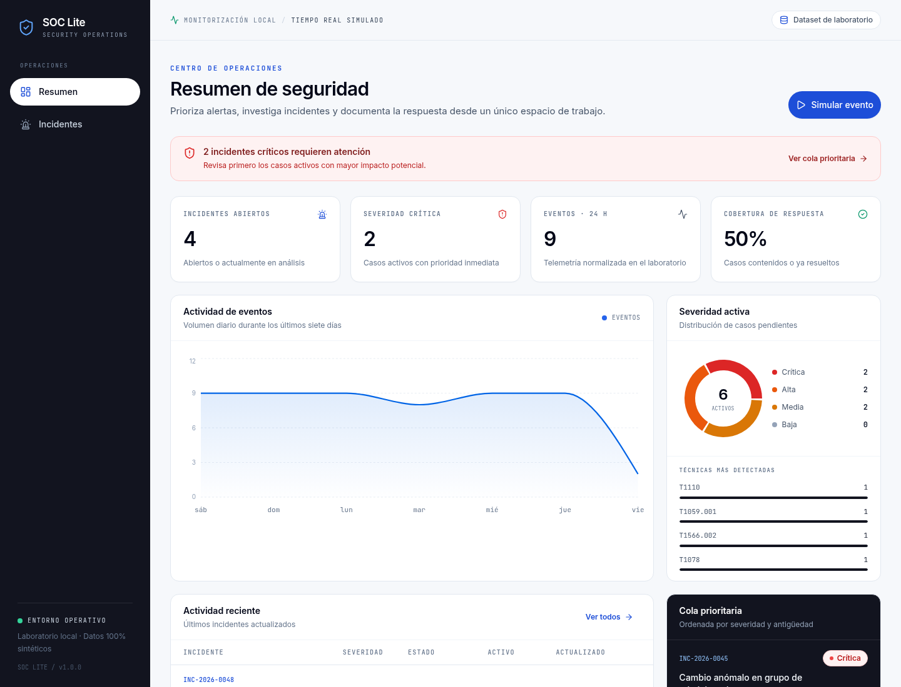
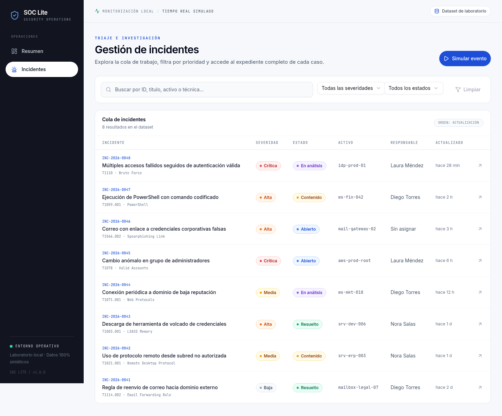
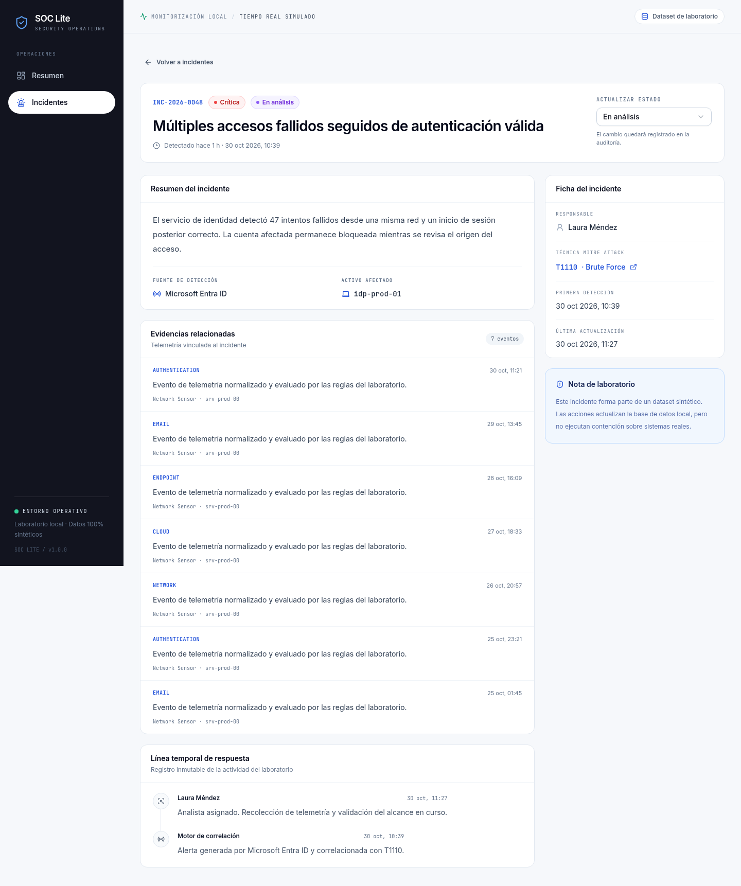
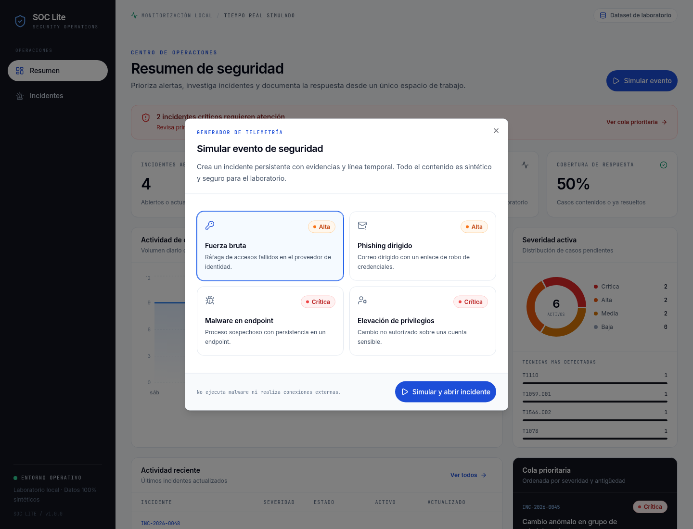

# SOC Lite

**Centro de operaciones de seguridad para triaje, investigación y respuesta a incidentes.** Proyecto full-stack diseñado como laboratorio local y pieza de portfolio: utiliza datos sintéticos, no requiere servicios de pago y puede ejecutarse con un solo comando de Docker Compose.



## Funcionalidades

- **Dashboard operativo** con incidentes abiertos, severidad crítica, eventos de las últimas 24 horas y cobertura de respuesta.
- **Visualizaciones calculadas desde la base de datos**: actividad de siete días, distribución por severidad y técnicas MITRE ATT&CK más detectadas.
- **Gestión de incidentes** con búsqueda por referencia, título, activo o técnica, además de filtros combinables por severidad y estado.
- **Expediente de investigación** con descripción, activo, fuente, evidencias relacionadas y ficha técnica.
- **Línea temporal de respuesta** que registra detecciones, cambios de estado y acciones de contención.
- **Simulador defensivo** con cuatro escenarios: fuerza bruta, phishing, malware en endpoint y elevación de privilegios.
- **Persistencia real en MySQL**, migraciones versionadas y seed idempotente para iniciar la demo.
- **Interfaz responsive**, estados de carga, error y vacío, navegación por teclado y soporte para movimiento reducido.

## Stack técnico

| Capa | Tecnologías |
| --- | --- |
| Frontend | React 19, TypeScript, Vite, Tailwind CSS, shadcn/ui, Recharts |
| Backend | Hono, tRPC, Zod |
| Datos | MySQL 8.4, Drizzle ORM, migraciones SQL |
| Ejecución local | Docker, Docker Compose, Node.js 20 |
| Calidad | Vitest, ESLint, TypeScript, comprobaciones en navegador |

## Inicio rápido con Docker

### Requisitos

- Docker Engine o Docker Desktop.
- Docker Compose v2.

Clona el repositorio, entra en su directorio y ejecuta:

```bash
docker compose up --build
```

Abre **http://localhost:3000**. Durante el primer arranque, la aplicación aplica las migraciones y crea automáticamente ocho incidentes y 56 eventos de demostración.

Los datos se conservan en el volumen `soc_mysql_data`. Para detener los servicios:

```bash
docker compose down
```

Si quieres borrar también la base de datos local y volver a empezar desde cero:

```bash
docker compose down -v
```

> El comando anterior elimina únicamente el volumen de datos de este proyecto. Los cambios que hayas realizado en incidentes se perderán.

## Desarrollo sin ejecutar la app en Docker

Necesitas Node.js 20 o superior. Puedes usar el contenedor de MySQL incluido en Compose:

```bash
docker compose up -d db
cp .env.example .env
npm install
npm run db:migrate
npm run db:seed
npm run dev
```

La aplicación queda disponible en **http://localhost:3000** con recarga en caliente. Si utilizas otro servidor MySQL, ajusta `DATABASE_URL` en `.env`.

Para comprobar la compilación de producción:

```bash
npm run build
npm start
```

## Scripts

| Comando | Propósito |
| --- | --- |
| `npm run dev` | Inicia frontend y API en modo desarrollo |
| `npm run build` | Genera los bundles de frontend y servidor |
| `npm start` | Ejecuta la compilación de producción |
| `npm run check` | Comprueba los tipos de TypeScript |
| `npm run lint` | Ejecuta ESLint |
| `npm run test` | Ejecuta las pruebas con Vitest |
| `npm run db:migrate` | Aplica las migraciones pendientes |
| `npm run db:seed` | Carga el dataset inicial si la base está vacía |
| `npm run db:generate` | Genera una migración tras modificar el esquema |

## Flujo de la demo

1. Abre el dashboard y revisa la cola prioritaria.
2. Pulsa **Simular evento** y elige un escenario.
3. La API crea el evento, el incidente y su primera entrada de auditoría en una transacción.
4. Abre el expediente, revisa las evidencias y cambia el estado a **En análisis**, **Contenido** o **Resuelto**.
5. Vuelve al listado o al dashboard: las métricas y gráficas se actualizan desde MySQL.

El simulador no ejecuta malware, no envía correos y no realiza conexiones contra sistemas externos. Toda la telemetría es ficticia.

## Capturas adicionales

### Gestión y filtrado de incidentes



### Detalle e investigación



### Simulador de eventos



## Estructura del proyecto

```text
├── api/                 # Servidor Hono, routers tRPC y acceso a datos
├── contracts/           # Enumeraciones y catálogos compartidos
├── db/                  # Esquema Drizzle, migraciones y seed
├── docs/screenshots/    # Imágenes para README y portfolio
├── public/              # Recursos estáticos
├── src/
│   ├── components/      # Layout, tablas, badges y simulador
│   ├── lib/             # Utilidades y pruebas
│   ├── pages/           # Dashboard, incidentes y detalle
│   ├── providers/       # Cliente tRPC y React Query
│   └── types/           # Tipos inferidos desde la API
├── compose.yaml         # MySQL + aplicación
└── Dockerfile           # Build y ejecución de producción
```

## Alcance y siguientes fases

Esta primera versión se centra en el recorrido principal y en la ejecución local. No incluye autenticación ni autorización; **no debe exponerse a Internet tal como está**.

Ampliaciones previstas:

- Autenticación y roles de administrador, analista y auditor.
- Editor de reglas de detección configurables.
- Ingesta de logs mediante CSV/JSON.
- Asignación de incidentes y notas de investigación.
- Exportación de informes y evidencias.
- Pruebas de integración adicionales para API y base de datos.

## Créditos

Las tipografías, iconos y referencias técnicas de terceros se detallan en [CREDITS.md](CREDITS.md).
